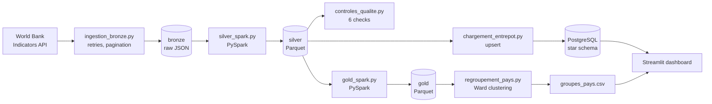

# AfriMacro

[Version française](README.md)

[](https://github.com/310bsko/afrimacro/actions/workflows/tests.yml)

An end-to-end data platform on West African economic indicators. It collects World Bank data, stores it in layers (bronze, silver, gold), loads a PostgreSQL star-schema warehouse, and serves a Streamlit dashboard.

Personal portfolio project in Data Engineering and Cloud Computing (Master 2 ID2C, ESATIC).

**Live dashboard: https://afrimacro-indicateur.streamlit.app/**

## What it does

- Collects **15 indicators for 15 West African countries, 1990-2025** (8,100 observations) from the World Bank Indicators API.
- Keeps the raw API responses untouched (**bronze**), cleans and types them with PySpark (**silver**, Parquet), and computes recent averages and country profiles (**gold**).
- Runs **6 data-quality checks** on every run (4 blocking, 2 warnings) and writes a CSV report.
- Loads an **idempotent** PostgreSQL star schema: running the load twice gives the same state.
- Serves a **Streamlit dashboard**: indicator evolution, country ranking, country profiles, and groups of similar countries (hierarchical clustering, Ward).

## Architecture



More detail in [docs/architecture.md](docs/architecture.md). Every table and column is described in [docs/data_dictionary.md](docs/data_dictionary.md). Both documents are written in French.

## Tech stack

| Component | Choice |
| --- | --- |
| Language and environment | Python 3.12, managed with [uv](https://docs.astral.sh/uv/) |
| Transformation | PySpark (local mode) |
| File storage | Parquet (silver, gold), JSON (bronze) |
| Warehouse | PostgreSQL 17 in Docker Compose |
| Analysis | pandas, scikit-learn, SciPy (Ward hierarchical clustering) |
| Dashboard | Streamlit, Plotly |
| Tests and CI | pytest, GitHub Actions |

## Quick start

Prerequisites: Docker with Docker Compose, [uv](https://docs.astral.sh/uv/), and Java 21 (required by PySpark, with `JAVA_HOME` set).

```bash
git clone https://github.com/310bsko/afrimacro.git
cd afrimacro
uv sync

cp .env.example .env            # then set a real POSTGRES_PASSWORD in .env
docker compose up -d            # starts PostgreSQL

docker compose exec -T base_donnees psql -U afrimacro -d afrimacro -v ON_ERROR_STOP=1 < entrepot/schema.sql
docker compose exec -T base_donnees psql -U afrimacro -d afrimacro -v ON_ERROR_STOP=1 < entrepot/vues.sql

./lancer_pipeline.sh            # ingestion -> silver -> quality checks -> gold -> warehouse -> snapshot
uv run python regroupement_pays.py   # optional: groups of similar countries
uv run --env-file .env exporter_instantane.py   # republish the snapshot with the country groups
uv run --env-file .env streamlit run tableau_de_bord/dashboard.py
```

**Try the dashboard without a database.** The repository contains a data snapshot (`tableau_de_bord/instantane/`). After `uv sync`, `uv run streamlit run tableau_de_bord/dashboard.py` is enough: without PostgreSQL, the dashboard reads this snapshot and says so at the top of the page.

Run the tests (no network or database needed):

```bash
uv run python -m pytest -v
```

Countries, indicators, period and gold parameters are set in `config/pipeline.yml`. Adding a country or an indicator only requires editing that file.

## Project structure

```
afrimacro/
├── config/pipeline.yml          # countries, indicators, period, gold parameters
├── ingestion_bronze.py          # API -> bronze (retries, pagination, never overwrites)
├── silver_spark.py              # bronze -> silver (PySpark, Parquet)
├── controles_qualite.py         # data-quality checks + CSV report
├── gold_spark.py                # silver -> gold (recent averages, country profiles)
├── chargement_entrepot.py       # silver -> PostgreSQL (idempotent upsert)
├── analyse_pays.py              # data preparation for clustering
├── regroupement_pays.py         # Ward hierarchical clustering
├── exporter_instantane.py       # warehouse -> Parquet snapshot for the online dashboard
├── tableau_de_bord/             # Streamlit dashboard, data access, versioned snapshot
├── lancer_pipeline.sh           # runs the whole pipeline in order
├── entrepot/                    # schema.sql, vues.sql
├── tests/                       # pytest tests (no network needed)
├── docs/                        # architecture and data dictionary
├── docker-compose.yml           # PostgreSQL
└── .github/workflows/tests.yml  # tests on every push
```

Data folders (`donnees/`) and secrets (`.env`) are never versioned.

## Design decisions

- **Raw data is never modified.** Bronze files are written once, named with the UTC collection timestamp, and never overwritten. Silver can always be rebuilt from bronze.
- **Idempotence.** Silver is recomputed from bronze. The warehouse is loaded with an upsert on the composite key (country, indicator, source, year), so a second run creates no duplicates and a revised value replaces the old one.
- **Missing values are never invented.** They stay `NULL`, are counted by the quality checks, and gold only calls an average reliable when at least 70% of the years are present.
- **Fail loudly.** A failing blocking check makes the script exit with code 1, and `lancer_pipeline.sh` stops before anything is loaded into the warehouse.
- **The database enforces the rules too.** Primary keys, foreign keys and check constraints refuse duplicates, unknown countries and absurd years, in addition to the Spark checks.
- **Secrets stay out of the repository.** Credentials live in `.env`, which is git-ignored, and PostgreSQL only listens on `127.0.0.1`.
- **The dashboard reads the database, or else a snapshot.** On the local machine it queries PostgreSQL. Online there is no database: it reads a frozen copy of the `vue_observations` view (Parquet, versioned in Git) and shows the date of that copy. The origin of the data is never hidden.

## Data quality checks

| Check | Level | What it verifies |
| --- | --- | --- |
| `cle_unique` | blocking | no duplicate (country, indicator, year) |
| `colonnes_obligatoires` | blocking | country, indicator, year and source are never empty |
| `grille_complete` | blocking | one row for every country x indicator x year |
| `valeurs_plausibles` | blocking | population > 0, percentages between 0 and 100, no value for a future year |
| `couverture_suffisante` | warning | each country-indicator pair has at least 70% of its years |
| `fraicheur` | warning | the latest year with data is recent compared with the collection date |

## Live dashboard

The dashboard is hosted on Streamlit Community Cloud (main file `tableau_de_bord/dashboard.py`). It cannot reach the local PostgreSQL database: it reads the versioned snapshot in `tableau_de_bord/instantane/` and shows the date of that copy at the top of the page. Its dependencies are limited to `tableau_de_bord/requirements.txt` (no Spark).

To publish new data: run `./lancer_pipeline.sh` (its last step rewrites the snapshot), then `git add tableau_de_bord/instantane`, commit and push. The host redeploys the dashboard after the push.

## Results and limitations

Observations from the 13 November 2026 collection (World Bank data last updated on 11 November 2026):

- 515 of the 8,100 observations (6.4%) are missing. Gaps are mostly old years or specific countries, for example no export or import data for Liberia and Nigeria over 2015-2024.
- Hierarchical clustering (Ward, 12 standardized indicators, 2015-2024 averages) isolates **Cabo Verde** and **Nigeria** as atypical profiles. The other 13 countries show no clear subgroups (silhouette around 0.2 for 4 to 6 groups).

Limitations, stated plainly:

- **The volume is small** (8,100 rows). Spark is not needed at this size. It is used so that the pipeline design stays valid if countries, indicators or years are added.
- Data is **annual**; the most recent years are often incomplete. Some series are modeled estimates (for example ILO unemployment).
- With **15 countries** the clustering is exploratory. Three indicators with gaps (exports, imports, current account) are excluded from it.
- Only **one source** (World Bank) is used in this version, so definitions and revisions cannot yet be compared across sources.
- The project **describes and compares**. It makes no forecast and no causal claim.

## Data sources and attribution

Source: World Bank, [Indicators API v2](https://datahelpdesk.worldbank.org/knowledgebase/articles/889392-about-the-indicators-api-documentation). World Bank datasets are published by default under the CC BY 4.0 licence unless labelled otherwise ([terms of use](https://www.worldbank.org/en/about/legal/terms-of-use-for-datasets)). The data is aggregated and transformed for this project, which is not endorsed by or affiliated with the World Bank.

## Roadmap

- Add the IMF DataMapper API as a second source, to compare sources and flag projections.
- Run a scale test on simulated data (millions of rows) and document the timings.
- Add a read-only database role for the dashboard, and host a managed cloud database (the live dashboard currently reads a snapshot).
- Schedule the pipeline in CI.

## Author

Bakayoko Soumaila, Master 2 Ingénierie Data et Cloud Computing (ID2C), ESATIC, Abidjan.
