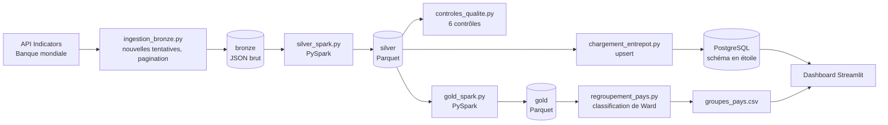

# AfriMacro

[English version](README.en.md)

[](https://github.com/310bsko/afrimacro/actions/workflows/tests.yml)

Plateforme de données de bout en bout sur les indicateurs économiques de l'Afrique de l'Ouest. Elle collecte les données de la Banque mondiale, les range en couches (bronze, silver, gold), alimente un entrepôt PostgreSQL en étoile et propose un dashboard Streamlit.

Projet personnel de portfolio en ingénierie des données et cloud computing (Master 2 ID2C, ESATIC).

**Dashboard en ligne : <URL_DU_DASHBOARD>**

## Ce que fait le projet

- Il collecte **15 indicateurs pour 15 pays d'Afrique de l'Ouest, de 1990 à 2025** (8 100 observations) via l'API Indicators de la Banque mondiale.
- Il conserve les réponses brutes de l'API sans les modifier (**bronze**), les nettoie et les type avec PySpark (**silver**, Parquet), puis calcule des moyennes récentes et des profils de pays (**gold**).
- Il exécute **6 contrôles de qualité** à chaque lancement (4 bloquants, 2 avertissements) et écrit un rapport CSV.
- Il charge un entrepôt PostgreSQL en étoile de façon **idempotente** : relancer le chargement donne le même état.
- Il propose un **dashboard Streamlit** : évolution d'un indicateur, classement des pays, profils de pays, et groupes de pays qui se ressemblent (classification hiérarchique, méthode de Ward).

## Architecture



Plus de détails dans [docs/architecture.md](docs/architecture.md). Chaque table et chaque colonne est décrite dans [docs/data_dictionary.md](docs/data_dictionary.md).

## Technologies

| Composant | Choix |
| --- | --- |
| Langage et environnement | Python 3.12, géré avec [uv](https://docs.astral.sh/uv/) |
| Transformation | PySpark (mode local) |
| Stockage de fichiers | Parquet (silver, gold), JSON (bronze) |
| Entrepôt | PostgreSQL 17 dans Docker Compose |
| Analyse | pandas, scikit-learn, SciPy (classification hiérarchique de Ward) |
| Dashboard | Streamlit, Plotly |
| Tests et intégration continue | pytest, GitHub Actions |

## Démarrage rapide

Prérequis : Docker avec Docker Compose, [uv](https://docs.astral.sh/uv/), et Java 21 (nécessaire à PySpark, avec la variable `JAVA_HOME` définie).

```bash
git clone https://github.com/310bsko/afrimacro.git
cd afrimacro
uv sync

cp .env.example .env            # puis mets un vrai mot de passe POSTGRES_PASSWORD dans .env
docker compose up -d            # démarre PostgreSQL

docker compose exec -T base_donnees psql -U afrimacro -d afrimacro -v ON_ERROR_STOP=1 < entrepot/schema.sql
docker compose exec -T base_donnees psql -U afrimacro -d afrimacro -v ON_ERROR_STOP=1 < entrepot/vues.sql

./lancer_pipeline.sh                 # ingestion -> silver -> contrôles -> gold -> entrepôt -> instantané
uv run python regroupement_pays.py   # facultatif : groupes de pays qui se ressemblent
uv run --env-file .env exporter_instantane.py   # republie l'instantané avec les groupes de pays
uv run --env-file .env streamlit run tableau_de_bord/dashboard.py
```

**Essayer le dashboard sans base de données.** Le dépôt contient un instantané des données (`tableau_de_bord/instantane/`). Après `uv sync`, la commande `uv run streamlit run tableau_de_bord/dashboard.py` suffit : sans PostgreSQL, le dashboard lit cet instantané et l'indique en haut de page.

Lancer les tests (ni réseau ni base de données nécessaires) :

```bash
uv run python -m pytest -v
```

Les pays, les indicateurs, la période et les paramètres du gold se règlent dans `config/pipeline.yml`. Ajouter un pays ou un indicateur ne demande que de modifier ce fichier.

## Structure du projet

```
afrimacro/
├── config/pipeline.yml          # pays, indicateurs, période, paramètres du gold
├── ingestion_bronze.py          # API -> bronze (nouvelles tentatives, pagination, jamais d'écrasement)
├── silver_spark.py              # bronze -> silver (PySpark, Parquet)
├── controles_qualite.py         # contrôles de qualité + rapport CSV
├── gold_spark.py                # silver -> gold (moyennes récentes, profils de pays)
├── chargement_entrepot.py       # silver -> PostgreSQL (upsert idempotent)
├── analyse_pays.py              # préparation des données pour le regroupement
├── regroupement_pays.py         # classification hiérarchique de Ward
├── exporter_instantane.py       # entrepôt -> instantané Parquet pour la mise en ligne
├── tableau_de_bord/             # dashboard Streamlit, accès aux données, instantané versionné
├── lancer_pipeline.sh           # lance tout le pipeline dans l'ordre
├── entrepot/                    # schema.sql, vues.sql
├── tests/                       # tests pytest (sans réseau)
├── docs/                        # architecture et dictionnaire de données
├── docker-compose.yml           # PostgreSQL
└── .github/workflows/tests.yml  # tests à chaque push
```

Les dossiers de données (`donnees/`) et les secrets (`.env`) ne sont jamais versionnés.

## Choix de conception

- **Les données brutes ne sont jamais modifiées.** Un fichier bronze est écrit une seule fois, nommé avec l'horodatage UTC de la collecte, et jamais écrasé. Le silver peut toujours être reconstruit depuis le bronze.
- **Idempotence.** Le silver est recalculé depuis le bronze. L'entrepôt est chargé par un upsert sur la clé composée (pays, indicateur, source, année) : une deuxième exécution ne crée aucun doublon, et une valeur révisée remplace l'ancienne.
- **Les valeurs manquantes ne sont jamais inventées.** Elles restent vides (`NULL`), elles sont comptées par les contrôles de qualité, et le gold ne juge une moyenne fiable que si au moins 70 % des années sont renseignées.
- **Échouer bruyamment.** Un contrôle bloquant qui échoue fait sortir le script avec le code 1, et `lancer_pipeline.sh` s'arrête avant que quoi que ce soit soit chargé dans l'entrepôt.
- **La base applique aussi les règles.** Les clés primaires, les clés étrangères et les contraintes de vérification refusent les doublons, les pays inconnus et les années absurdes, en plus des contrôles Spark.
- **Les secrets restent hors du dépôt.** Les identifiants sont dans `.env`, ignoré par Git, et PostgreSQL n'écoute que sur `127.0.0.1`.
- **Le dashboard lit la base, ou à défaut un instantané.** Sur le poste local, il interroge PostgreSQL. En ligne, il n'y a pas de base : il lit une copie figée de la vue `vue_observations` (Parquet, versionnée dans Git) et affiche la date de cette copie. L'origine des données n'est jamais cachée.

## Contrôles de qualité

| Contrôle | Niveau | Ce qu'il vérifie |
| --- | --- | --- |
| `cle_unique` | bloquant | aucun doublon sur (pays, indicateur, année) |
| `colonnes_obligatoires` | bloquant | pays, indicateur, année et source ne sont jamais vides |
| `grille_complete` | bloquant | une ligne pour chaque combinaison pays x indicateur x année |
| `valeurs_plausibles` | bloquant | population > 0, pourcentages entre 0 et 100, aucune valeur pour une année future |
| `couverture_suffisante` | avertissement | chaque couple pays-indicateur a au moins 70 % de ses années renseignées |
| `fraicheur` | avertissement | la dernière année renseignée est récente par rapport à la date de collecte |

## Dashboard en ligne

Le dashboard est hébergé sur Streamlit Community Cloud (fichier principal `tableau_de_bord/dashboard.py`). Il n'a pas accès à la base PostgreSQL locale : il lit l'instantané versionné dans `tableau_de_bord/instantane/` et affiche en haut de page la date de cette copie. Ses dépendances sont limitées à `tableau_de_bord/requirements.txt` (pas de Spark).

Pour publier de nouvelles données : lancer `./lancer_pipeline.sh` (la dernière étape réécrit l'instantané), puis `git add tableau_de_bord/instantane`, un commit et un push. L'hébergeur redéploie le dashboard après le push.

## Résultats et limites

Constats de la collecte du 13 novembre 2026 (données de la Banque mondiale mises à jour le 11 novembre 2026) :

- 515 des 8 100 observations (6,4 %) sont manquantes. Les trous concernent surtout des années anciennes ou certains pays, par exemple aucune donnée d'exportations ni d'importations pour le Liberia et le Nigeria sur 2015-2024.
- La classification hiérarchique (Ward, 12 indicateurs standardisés, moyennes 2015-2024) isole le **Cap-Vert** et le **Nigeria** comme profils atypiques. Les 13 autres pays ne montrent aucun sous-groupe net (silhouette autour de 0,2 pour 4 à 6 groupes).

Les limites, énoncées clairement :

- **Le volume est faible** (8 100 lignes). Spark n'est pas nécessaire à cette taille. Il est utilisé pour que la conception du pipeline reste valable si on ajoute des pays, des indicateurs ou des années.
- Les données sont **annuelles**, et les années les plus récentes sont souvent incomplètes. Certaines séries sont des estimations modélisées (par exemple le chômage de l'OIT).
- Avec **15 pays**, le regroupement est exploratoire. Trois indicateurs incomplets (exportations, importations, compte courant) en sont exclus.
- **Une seule source** (Banque mondiale) est utilisée dans cette version : on ne peut pas encore comparer les définitions et les révisions entre sources.
- Le projet **décrit et compare**. Il ne fait aucune prévision et n'affirme aucun lien de cause à effet.

## Sources et attribution

Source : Banque mondiale, [API Indicators v2](https://datahelpdesk.worldbank.org/knowledgebase/articles/889392-about-the-indicators-api-documentation). Les jeux de données de la Banque mondiale sont publiés par défaut sous licence CC BY 4.0, sauf mention contraire ([conditions d'utilisation](https://www.worldbank.org/en/about/legal/terms-of-use-for-datasets)). Les données sont agrégées et transformées dans le cadre de ce projet, qui n'est ni approuvé par la Banque mondiale, ni affilié à elle.

## Feuille de route

- Ajouter l'API DataMapper du FMI comme deuxième source, pour comparer les sources et repérer les projections.
- Faire un test de montée en charge sur des données simulées (millions de lignes) et documenter les temps.
- Ajouter un rôle de base de données en lecture seule pour le dashboard, et héberger une base managée dans le cloud (le dashboard en ligne lit pour l'instant un instantané).
- Planifier le pipeline en intégration continue.

## Auteur

Bakayoko Soumaila, Master 2 Ingénierie Data et Cloud Computing (ID2C), ESATIC, Abidjan.
