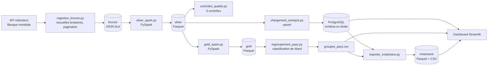
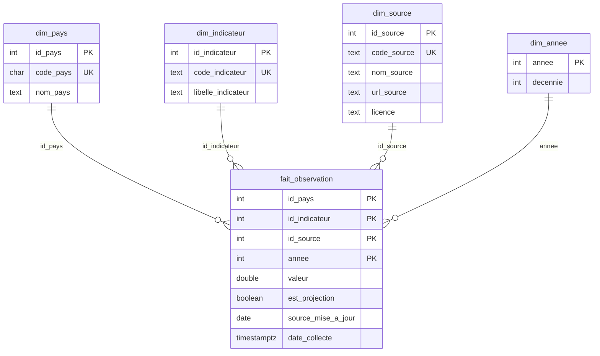

# Architecture

## Flux de données

## Les couches

| Couche | Emplacement | Format | Rôle |
| --- | --- | --- | --- |
| bronze | `donnees/bronze/banque_mondiale/<indicateur>/<horodatage>.json` | JSON | Réponses brutes de l'API, dans une enveloppe qui contient la source, la requête et la date de collecte. Écrites une seule fois, jamais modifiées. |
| silver | `donnees/silver/indicateurs_banque_mondiale` | Parquet | Données nettoyées et typées, une ligne par pays, indicateur et année. Seule la dernière collecte de chaque indicateur est retenue. |
| gold | `donnees/gold/moyennes_recentes`, `donnees/gold/profil_pays` | Parquet | Moyennes récentes avec un indicateur de fiabilité, et une ligne par pays pour le regroupement. |
| entrepôt | PostgreSQL | tables et vues | Schéma en étoile interrogé par le dashboard. |
| instantané | `tableau_de_bord/instantane/` | Parquet, CSV, JSON | Copie figée de la vue `vue_observations` et des groupes de pays, versionnée dans Git. Lue par le dashboard quand la base n'est pas disponible (hébergement en ligne). |

## Modèle de l'entrepôt (schéma en étoile)

La table de faits contient une ligne par pays, indicateur, source et année. La clé primaire composée garantit l'unicité. La vue `vue_observations` joint les quatre dimensions : c'est le seul objet que lit le dashboard.

## Ordre d'exécution et comportement en cas d'échec

`lancer_pipeline.sh` enchaîne : ingestion, silver, contrôles de qualité, gold, chargement de l'entrepôt, export de l'instantané. Il s'arrête à la première étape en échec (`set -euo pipefail`). Un contrôle bloquant qui échoue sort avec le code 1 : des données incorrectes n'arrivent donc jamais dans l'entrepôt.

## Mise en ligne du dashboard

Le dashboard hébergé en ligne n'a pas accès à PostgreSQL, qui tourne sur le poste local. Le dashboard lit donc ses données par `tableau_de_bord/acces_donnees.py` :

1. si les variables `POSTGRES_*` sont définies et que la base répond, il lit la vue `vue_observations` ;
2. sinon, il lit l'instantané `tableau_de_bord/instantane/observations.parquet`, produit par `exporter_instantane.py` avec le même code de lecture, donc avec les mêmes colonnes et les mêmes types.

La page indique toujours l'origine des données (base ou date de l'instantané). Si aucune source n'est disponible, un message clair remplace le plantage.

Le dossier `tableau_de_bord/` contient son propre `requirements.txt` (Streamlit, pandas, Plotly, pyarrow). Streamlit Community Cloud cherche d'abord le fichier de dépendances dans le dossier du fichier principal : ce fichier prime donc sur le `uv.lock` de la racine, qui installerait aussi Spark et scikit-learn, inutiles pour l'affichage.

Limite : l'instantané est une copie figée. Il faut republier (export, commit, push) pour mettre à jour le dashboard en ligne. Une base managée dans le cloud est prévue dans la feuille de route.

## Idempotence

| Étape | Pourquoi une deuxième exécution ne change rien |
| --- | --- |
| Bronze | Chaque exécution ajoute de nouveaux fichiers horodatés. Rien n'est écrasé, et l'historique est conservé. |
| Silver, gold | Recalculés depuis le bronze avec `overwrite`. Une même entrée donne la même sortie. |
| Entrepôt | Upsert (`INSERT ... ON CONFLICT DO UPDATE`) sur la clé primaire, dans une seule transaction. |
| Rapports | Un nouveau CSV horodaté à chaque exécution. |
| Instantané | Les fichiers sont réécrits à chaque export : ils ne s'accumulent pas. |

## Sécurité

- Les identifiants sont lus dans l'environnement (`.env`, ignoré par Git). `.env.example` documente les variables.
- PostgreSQL n'est publié que sur `127.0.0.1`.
- Les paramètres SQL sont toujours transmis séparément du texte de la requête.
- Prévu : un rôle de base de données en lecture seule pour le dashboard.
